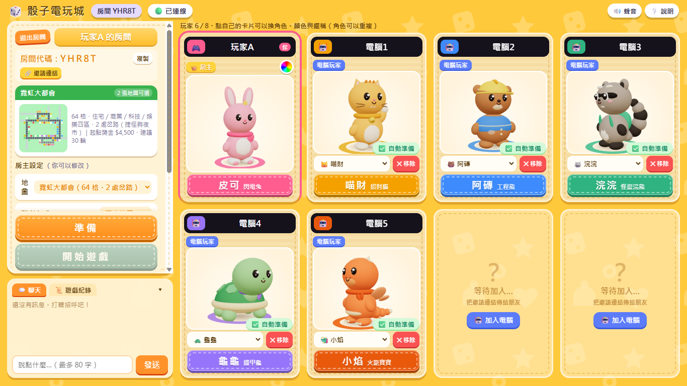
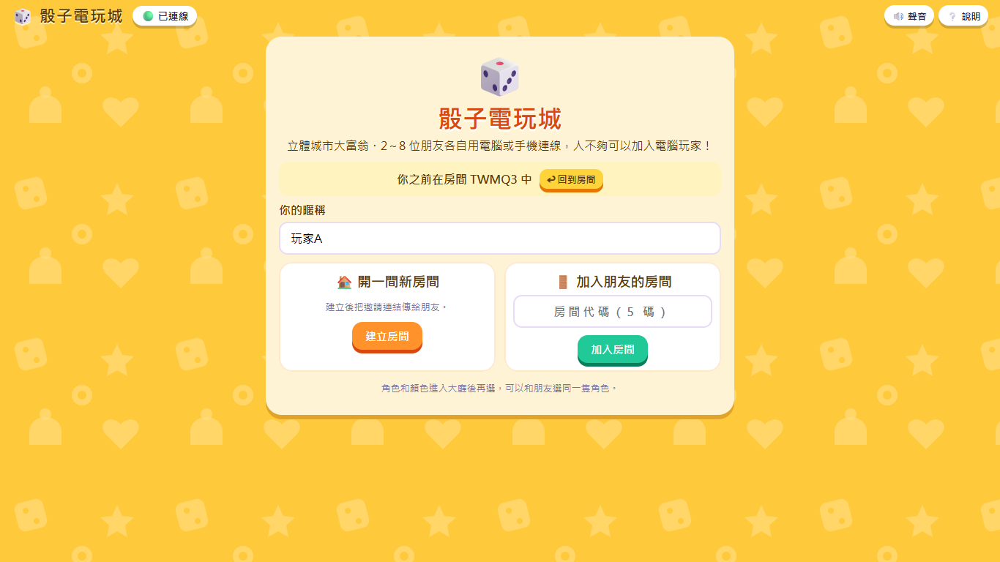
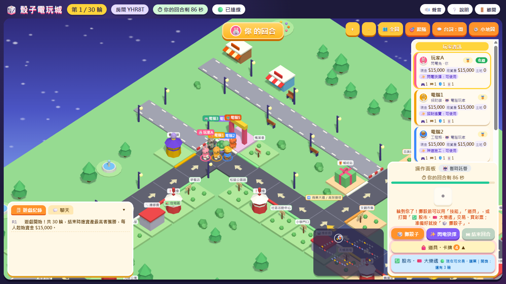
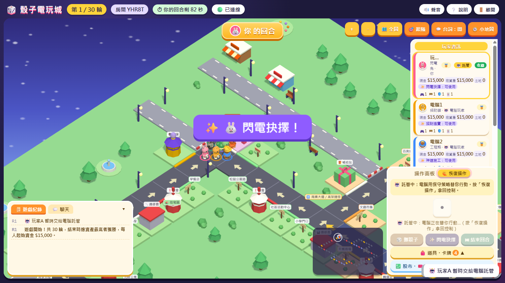
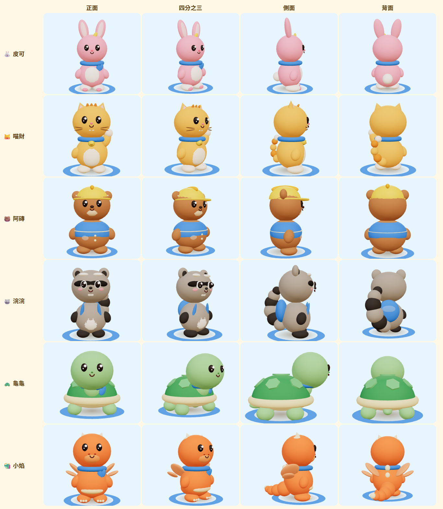

# 🎲 骰子電玩城 開發紀錄（city-dice-devlog）

一款**瀏覽器就能玩的 3D 城市大富翁**，從一句「我想做一個電玩大富翁」開始，到 2～8 人線上連線、AI 電腦玩家、掛機託管，最後部署到自己的 VPS、用固定 HTTPS 網址讓朋友直接玩。

這個儲存庫是**開發紀錄與教學**，記錄發想、製作、測試與部署的過程，以及 AI 協作的方法。
遊戲原始碼放在另一個私人儲存庫，這裡不包含原始碼。

> 作者是程式初學者，整個專案由 AI 協作完成：ChatGPT 負責需求討論與排錯引導，Claude Code 負責實作、測試與部署指令（見 [AI 協作方式](docs/02-AI協作與提示詞.md)）。



---

## 遊戲介紹

- **3D 城市**：斜角俯視的立體城市，角色沿著道路一格一格走，土地會從空地蓋成小屋、樓房、高級建築。
- **2～8 人線上連線**：每個人用自己的電腦或手機打開網址，輸入房間代碼加入；人不夠可以加入電腦玩家。
- **兩張地圖**：28 格「骰子城」，以及預設的 64 格「霓虹大都會」（四個區域、兩處岔路可以選路線）。
- **玩法**：買地、升級、收租、機會與命運、30 種迷因道具卡、每位角色的專屬技能、股市與大樂透（只用遊戲內金幣）。
- **掛機託管**：輪到你時顯示倒數，剩 10 秒提醒；連續兩回合逾時會改由電腦保守代打，也可以自己按「暫時託管」。
- **斷線不怕**：重新整理或斷線後會回到原本的席位；伺服器重開後房間會恢復，等大家回來再繼續。

| 首頁 | 對局（64 格全圖） |
|---|---|
|  |  |
| **跟隨鏡頭** | **暫時託管** |
|  |  |



> 截圖只使用本專案原創的六位角色，暱稱為範例；遊戲中另有依參考圖或既有作品製作的角色，因授權未確認或屬於他人著作，不放在公開展示中（見 [素材與授權](docs/07-素材與授權.md)）。

---

## 技術架構

```
玩家瀏覽器（HTML／CSS／JavaScript＋Three.js 3D）
        │  HTTPS／WebSocket（Socket.IO）
        ▼
Caddy（自動 HTTPS 憑證、HTTP 轉 HTTPS、反向代理）
        │  127.0.0.1:3000
        ▼
Node.js 遊戲伺服器（systemd 常駐）── 房間存檔（JSON，先寫暫存檔再改名）
```

| 部分 | 做法 |
|---|---|
| 前端 | 原生 HTML、CSS、JavaScript（沒有框架）；3D 用 **Three.js**，角色與建築全部用程式組成（沒有外部模型檔） |
| 連線 | **Socket.IO**（WebSocket）；前後端同一個網址 |
| 規則 | **伺服器說了算**：擲骰、抽卡、股價、開獎、金錢全部由伺服器決定，前端只送「我要做什麼」；每個操作帶版本號，重送或過期的請求會被拒絕 |
| 電腦玩家 | 伺服器端的規則策略程式（不使用任何語言模型或付費 API），只看得到公開資訊 |
| 聲音 | Web Audio API 即時合成的原創音樂與音效（沒有音訊檔） |
| 存檔 | 每間房一個 JSON；伺服器重啟後恢復、對局先暫停，玩家到齊再繼續 |
| 部署 | Linux VPS：Node.js 官方版本＋systemd＋Caddy＋免費 DuckDNS 網址＋Let's Encrypt 憑證 |
| 測試 | 規則測試 101 項＋連線／電腦玩家／股市／存檔／託管 94 項（Node.js 內建測試），以及無頭 Chrome 的畫面檢查 |

---

## 目前進度（2026-10-22）

| 項目 | 狀態 |
|---|---|
| 2～8 人線上對局、電腦玩家、30 種道具卡、角色技能、機會命運、股市與大樂透 | ✅ 完成並測試 |
| 64 格大地圖（岔路選擇）、小地圖 | ✅ |
| 房間存檔與恢復（重啟、當機、主機重開機） | ✅ 在正式主機實測 |
| 掛機與逾時託管 | ✅ 自動測試＋瀏覽器檢查；作者試玩確認可用 |
| 部署到 VPS、固定 HTTPS 網址 | ✅ 外部網路 8 人連線、重啟恢復、重開機驗證通過 |
| 8 位真人用不同裝置長時間同時遊玩 | ⏳ 尚未實測（目前是程式模擬 8 個連線） |
| 部分角色外觀與授權 | ⏳ 見 [待辦與限制](docs/06-待辦與限制.md) |

---

## 文件

| 文件 | 內容 |
|---|---|
| [01 開發歷程](docs/01-開發歷程.md) | 需求怎麼演變、每個階段做了什麼、遇到的問題與解法 |
| [02 AI 協作與提示詞](docs/02-AI協作與提示詞.md) | ChatGPT 與 Claude Code 的分工、可以重複使用的提示詞範本 |
| [03 本機安裝教學](docs/03-本機安裝教學.md) | Windows（PowerShell 與 CMD 分開說明、`npm.cmd`）、Linux |
| [04 VPS 部署教學](docs/04-VPS部署教學.md) | Windows 本機與 VPS SSH 分開標示：Node.js、systemd、房間存檔、DuckDNS、Caddy、HTTPS、驗證 |
| [05 費用說明](docs/05-費用說明.md) | 哪些免費、哪些可能要付費 |
| [06 待辦與限制](docs/06-待辦與限制.md) | 還沒完成或還沒實測的部分 |
| [07 素材與授權](docs/07-素材與授權.md) | 角色、模型、音樂與套件的來源和授權 |
| [補圖清單](docs/補圖清單.md) | 還缺、之後要補的截圖 |

---

## 說明

- 教學中的 IP、網址、帳號都是範例（例如 `203.0.113.10`、`your-game.duckdns.org`），請換成自己的。
- 不包含任何密碼、Token、API 金鑰、SSH 私鑰、WireGuard 設定、`.env` 或玩家存檔。
- 開發紀錄依 Git 提交紀錄與開發過程的對話整理，日期為台灣時間；沒有紀錄可查的內容不寫。

## 授權

- **本儲存庫中作者撰寫的教學文字**（README 與 `docs/` 內的說明、提示詞範本、指令範例）採用 **[創用 CC 姓名標示 4.0 國際（CC BY 4.0）](https://creativecommons.org/licenses/by/4.0/deed.zh-hant)**，完整條款見 [LICENSE](LICENSE)。轉載或改作時請標示出處（本儲存庫）與作者。
- **不包含在這份授權中**：
  - `images/` 內的遊戲截圖與其中的角色、畫面設計（保留所有權利，如需使用請先聯繫作者）。
  - 遊戲原始碼（另外的私人儲存庫，不在這裡）。
  - 第三方的軟體、服務、套件與商標（例如 Node.js、Three.js、Socket.IO、Caddy、Let's Encrypt、DuckDNS、GitHub、ChatGPT、Claude），依各自的授權與商標規範，屬於各自的權利人。
